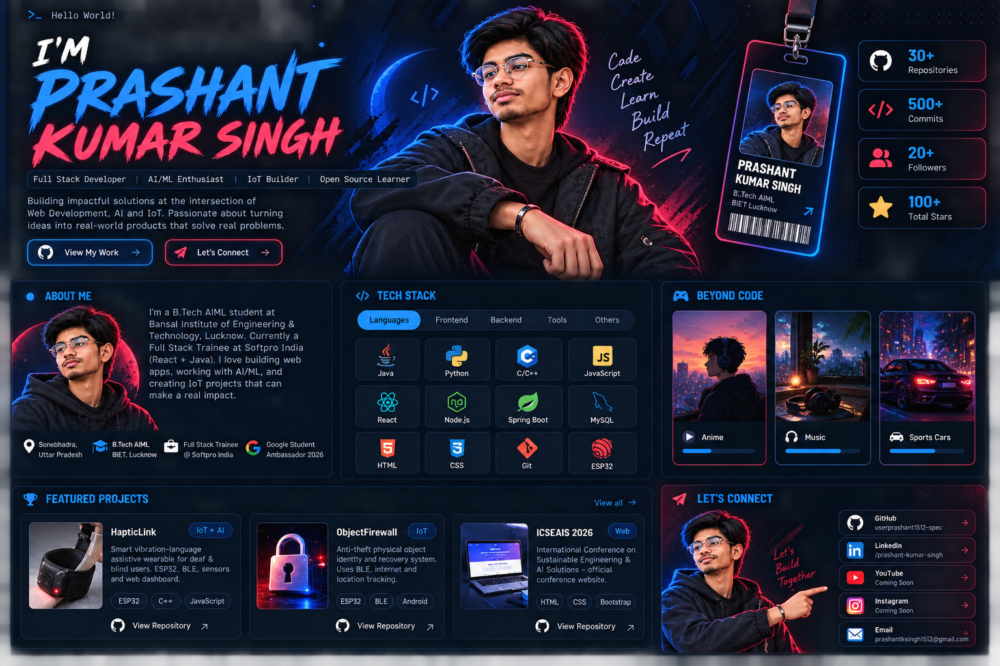

# 👋 Hey, I'm Prashant Kumar Singh

**Full Stack Developer · AI/ML Enthusiast · IoT Builder**

*Building useful things with code, AI, and hardware.*

---

## 👨‍💻 About Me

I'm a B.Tech AIML student who enjoys learning by building. I work on web development and explore AI/ML and IoT projects, especially ideas that can solve practical problems.

- 🎓 B.Tech AIML student at BIET, Lucknow
- 💻 Full-stack development trainee — React and Java
- 🤖 Interested in AI/ML, IoT, assistive technology, and backend development
- 🛠️ Learning by building projects and improving step by step

## 🧰 Tech Stack

## 🚀 Featured Projects

### HapticLink / Ankle Band
An assistive wearable concept using ESP32, sensors, BLE, and vibration alerts to help users notice environmental events.

[**View repository →**](https://github.com/userprashant1512-spec/Ankle-Band)

### ObjectFirewall
An anti-theft object identity and recovery concept exploring BLE/NFC, phone detection, and location reporting.

[**Find it on my GitHub →**](https://github.com/userprashant1512-spec)

### ICSEAIS 2026
A website for the International Conference on Sustainable Engineering & AI Solutions.

[**View repository →**](https://github.com/userprashant1512-spec/ICSEAIS2026)

## 🌌 Beyond Code

- 🎧 Music and discovering new artists
- 🎌 Anime
- 🚘 Sports cars
- 🎥 Creative video ideas
- 💡 Building projects with friends and exploring new tech

## 📊 GitHub Activity

<!-- These cards fetch live GitHub data from a third-party stats service. They may occasionally be unavailable. -->

## 🤝 Let's Connect

<!-- Add verified LinkedIn, email, YouTube, and Instagram URLs when you want them displayed. -->

---

*Code. Create. Learn. Build. Repeat.* ⚡

